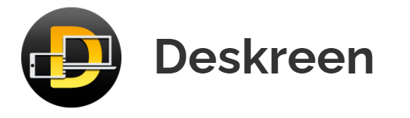
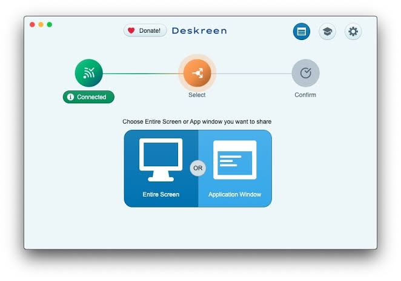

# Deskreen Browser Viewing for Your Computer Screen

Deskreen PC can put a computer's display on a tablet or another device through its browser.
Deskreen runs on the host computer; the receiving device opens the viewing page.
This guide focuses on deskreen community edition, the deskreen open source project, and the requirements behind a deskreen secondary screen.

[](https://deskreen-pc.github.io/Deskreen/)

## A second viewing surface is not another desktop

Mirroring shows an existing display on another device.
Extending the desktop creates additional operating-system workspace where you can place different windows.
Deskreen can transmit a screen that the host already exposes; the browser itself does not create that extra workspace.

For an extended desktop, arrange an additional display through a supported virtual display solution or a suitable display adapter.
An HDMI dummy plug can make a compatible host expose another display.
Select an extended layout in the operating system, move the intended content there, and share that display.

A shared application window is another option when the viewer only needs one document or presentation.
It can provide a useful reference surface without creating a new monitor.

The supplied desktop package identifies itself as Deskreen CE in [package.json](package.json).
Its dependency resolution snapshot is [package-lock.json](package-lock.json); dependency versions alone do not establish display-driver support.



## Keep control of what the browser sees

Connect the viewer and host through a local network that permits communication between them.
Open the address shown by Deskreen in the receiving browser, or scan the displayed QR code.
A camera is optional because the address can be entered manually.

Review the pending connection on the host before allowing it.
Then choose the intended screen or application window and confirm the selection.
For a presentation, sharing a single window can keep unrelated desktop material outside the selected source.

- Check the viewer device before approving a request.
- Verify the preview shows the intended content.
- Keep the host awake for the duration of the session.
- End sharing when the viewer no longer needs access.

The receiving browser displays a video stream.
Do not assume that viewing a screen provides remote keyboard, pointer, or stylus control.

## Check the edition before planning the session

The project's current feature comparison distinguishes Community Edition from paid editions.
Use that comparison when a general feature description on the website appears broader than the installed edition.

| Capability | Community Edition listing | Planning consequence |
| --- | --- | --- |
| Entire-screen sharing | Included | An existing host display can be the source |
| Single-window sharing | Included | One application can be selected |
| Connected devices | One | Plan a single viewer session |
| Teleprompter flip mode | Not included | Check a paid edition for built-in horizontal flipping |
| Advanced video controls | Not included | Do not promise manual quality controls in CE |

The package metadata and the historic [CHANGELOG.md](CHANGELOG.md) cover different points in the project's history.
The supplied changelog starts with older 1.x entries, so it is not a complete feature list for the 3.x package metadata.
Check the running edition rather than treating every historical screenshot or tutorial as current.



## Choose the address the viewer can reach

A host can have several network interfaces: wireless, Ethernet, VPN, or virtual adapters.
The address presented to a viewer must belong to an interface reachable from that device.
A guest network can block device-to-device traffic even when both devices use the same access point.

The CE repository documents **--local-ip** and its **--ip** alias for selecting a local address at launch.
For Windows PowerShell, run this from the directory containing the installed executable:

```powershell
# Replace this with an address assigned to the host's reachable network interface.
$viewerNetworkAddress = '192.168.1.34'
& '.\Deskreen CE.exe' --local-ip $viewerNetworkAddress
```

This selects an address; it does not assign a new address to the computer.
It also does not imply that Community Edition includes the paid graphical interface selector.
Use the fresh connection information displayed by the app after launch.

For an unreachable page, check the chosen interface, local firewall permission, and guest-network isolation.
For an approved connection without video, review the selected source and host screen-capture permissions.
Local network reachability is distinct from having access to the public internet.

On macOS, screen-capture permission is an operating-system decision.
The supplied [entitlements.mac.plist](build/entitlements.mac.plist) declares process entitlements, not a user's screen-recording consent.

## Read the host and viewer boundaries in the materials

Deskreen uses Electron for its desktop application and WebRTC for screen streaming.
The included TypeScript configuration separates desktop-side code from the renderer's interface code.
Those build targets should not be mistaken for user-facing screen-sharing presets.

The root [tsconfig.json](tsconfig.json) references the Node and web configurations.
[tsconfig.node.json](tsconfig.node.json) includes main-process, preload, server, and shared source paths.
[tsconfig.web.json](tsconfig.web.json) describes renderer compilation and its aliases.
Formatting and lint rules are supplied in [biome.json](biome.json).

The development updater configuration, [dev-app-update.yml](dev-app-update.yml), contains an example update URL.
That placeholder is not evidence of a working production update service.

## Distinguish application assets from display capabilities

The packaging configuration in [electron-builder.yml](electron-builder.yml) identifies the desktop product and platform targets.
This YAML excerpt illustrates the supplied Windows package identity and formats:

```yaml
appId: com.deskreen-ce.app
productName: Deskreen CE
win:
  executableName: Deskreen CE
  target:
    - portable
    - msi
```

These settings describe distributed artifacts; they do not create a virtual monitor or configure streaming quality.
The supplied image assets serve application branding and platform packaging:

| Asset role | Supplied file |
| --- | --- |
| Runtime image resource | [icon.png](resources/icon.png) |
| General build image | [icon.png](build/icon.png) |
| Windows icon container | [icon.ico](build/icon.ico) |
| macOS icon container | [icon.icns](build/icon.icns) |
| Additional CE build artwork | [deskren-ce-icon.png](build/deskren-ce-icon.png) |

Version maintenance scripts are [bump-version.js](scripts/bump-version.js) and [undo-version-bump.js](scripts/undo-version-bump.js).
They operate on release metadata, not on the live viewer connection.
Project participation expectations are documented in [CODE_OF_CONDUCT.md](CODE_OF_CONDUCT.md).

## Scope and accompanying material

This snapshot contains packaging, configuration, scripts, and assets; it omits the main application and browser-viewer source.
The separately supplied [Deskreen.txt](Deskreen.txt) is a research brief, while [info.txt](info.txt) is currently an empty workspace placeholder.
Include those two root-level companions alongside the contents of the supplied source folder to preserve these links.
They are accompanying user-provided material rather than upstream Deskreen implementation files.
Examples were checked against available files and official documentation; no software was launched or local files changed.

## Related Search Terms

Deskreen PC, Deskreen, deskreen community edition, deskreen open source, deskreen secondary screen, deskreen, second-screen, share-screen, share-app-window, webrtc, electron, typescript, browser, screen-mirroring, wifi
